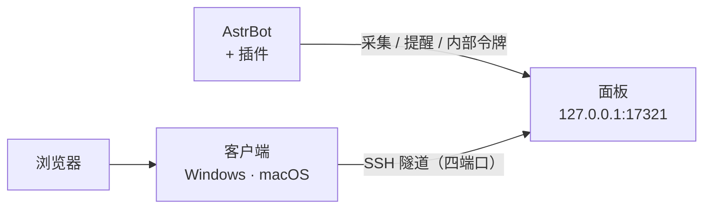

<div align="center">
  
</div>

<h1 align="center">Bot Manager</h1>

<p align="center">
  <b>AstrBot 的用量计量 · 余额提醒 · 运维面板 · 双平台客户端</b><br>
  <sub>插件负责采集与提醒，面板负责查询与展示，客户端负责把面板安全地拉到你自己的电脑上</sub>
</p>

<p align="center">
  <a href="https://github.com/AKIhunter/astrbot_plugin_bot_manager/releases"></a>
  
  
  
  
  
</p>

<div align="center">
  <sub>
    <a href="#-三分钟上手">快速上手</a> ·
    <a href="#-能力">能力</a> ·
    <a href="#-指令">指令</a> ·
    <a href="#-配置">配置</a> ·
    <a href="#-客户端">客户端</a> ·
    <a href="#-安全模型">安全</a> ·
    <a href="#-常见问题">FAQ</a>
  </sub>
</div>

---

## 🧭 三个部分，各管一段



| 部件 | 装在哪 | 负责 | 不装会怎样 |
| :--- | :--- | :--- | :--- |
| **插件** | AstrBot | 采集模型/向量用量、计量搜索、余额提醒、把凭据下发给面板 | 什么都不能用 |
| **配套服务** | 服务器 | 网页面板、资源与日志、余额查询、凭据落盘 | 只有用量与指令查询，没有余额 / 搜索汇总 / 网页 |
| **客户端** | 你的电脑 | 建 SSH 隧道、打开面板、生成密钥、重置服务密码 | 得自己敲 `ssh -L`，或只能从服务器本机访问 |

> **面板不对公网开放。** 它只监听服务器的 `127.0.0.1:17321`，必须经 SSH 隧道访问。
> 这不是「没做完」，是刻意的：把「谁能访问面板」收敛成「谁能登录这台服务器」。

---

## ✨ 能力

| | 你希望 | 行为与边界 |
| :--- | :--- | :--- |
| 💰 | **知道钱花在哪个插件** | 包装 AstrBot 提供商与底层客户端，按插件汇总调用、Token 与未知用量；排行只取前 10 |
| 🧠 | **分清聊天和记忆的消耗** | 模型调用与向量调用分别计量；重试、取消、失败按请求明细保留 |
| 🔍 | **搜索费用别混进模型账单** | 单独计量 DeepSeek 搜索与网页抓取，按你配置的单价换算 |
| 🔔 | **余额不足先知道** | 按周期查 DeepSeek 余额，跌破阈值提醒一次；充值后按人设致谢一次，不循环刷屏 |
| 🎯 | **提醒发给我或群里** | 插件设置页填 QQ 号与群号即可指定目标；不填时才回退旧行为 |
| 🔑 | **从插件里配好一切** | 直接填 DeepSeek 密钥与面板密码（账号固定 `admin`），改动自动下发，改密立即生效 |
| 📱 | **手机 / 异地也能看** | 客户端配 SSH 私钥建隧道，在自己电脑的浏览器里打开面板 |
| 📖 | **忘了有哪些指令** | 读取真实注册表，列出名称、别名、参数、权限与停用状态；查询不执行命令 |

> 不做的事：不自动切换更便宜的模型、不替你限额或充值、不复制其他插件的数据库、不在未授权时执行任何指令。

---

## 🚀 三分钟上手

**1 · 装插件**（AstrBot ≥ 4.29.0）

插件市场搜 `astrbot_plugin_usage_telemetry`，或用仓库地址安装：

```
https://github.com/AKIhunter/astrbot_plugin_bot_manager
```

装好启用后，用管理员发 `/bm 状态`。

**2 · 验证采集**

让机器人正常完成一次模型任务，再发 `/bm 用量 今天`；看到本次调用与 Token 即成功。
拿不到上游用量时应显示「未知」，**不是 0**。

**3 · 装配套服务**（需要余额 / 搜索汇总 / 网页时）

```bash
git clone https://github.com/AKIhunter/astrbot_plugin_bot_manager.git
cd astrbot_plugin_bot_manager
sudo sh service/install-server.sh service
```

> [!IMPORTANT]
> 安装器面向 **Linux + systemd + `/var/lib/astrbot` + `astrbot` 系统用户**，不是 Windows/macOS
> 或任意 Docker 布局的一键安装器。首次安装会打印**一次**面板密码，请立即保存。

**4 · 连面板**

下载 [客户端](https://github.com/AKIhunter/astrbot_plugin_bot_manager/releases)，
填服务器、私钥、面板账密，点「连接并打开面板」。

---

## 🧩 指令

全部管理入口仅限 AstrBot 管理员，默认前缀 `/`，入口支持 `/bm`、`/botmanager`、`/bot管理`。

| 指令 | 功能 |
| :--- | :--- |
| `/bm`、`/bm 帮助` | 帮助图或完整指令说明 |
| `/bm 状态` | 采集挂钩、搜索计量、提醒与凭据任务状态 |
| `/bm 余额` | DeepSeek 实时余额（兼容 `/余额`、`/钱包`、`/账户余额`） |
| `/bm 用量 [时间]` | 调用、Token、未知用量与插件排行 |
| `/bm 搜索 [时间]` | 搜索 / 抓取次数与计量费用 |
| `/bm 通知`、`/bm 通知 测试` | 查看提醒配置 / 向目标发一条测试消息 |
| `/bm 凭据`、`/bm 凭据 同步` | 查看凭据同步状态 / 立即重新下发 |
| `/bm 指令`、`/bm 详情` | 注册指令列表 / 完整原生命令说明 |

时间支持 `今天`、`昨天`、`7天`、`30天`、`全部`，按北京时间。

---

## ⚙️ 配置

插件设置页「Bot Manager 集成管理」，完整定义以 [`_conf_schema.json`](_conf_schema.json) 为准。常用项：

| 配置 | 默认 | 说明 |
| :--- | :--- | :--- |
| `notice_enable` | `true` | 余额提醒总开关；关掉后不再轮询，`/bm 余额` 仍可手查 |
| `low_balance_threshold` | `5.0` | 低于该值进入一个低余额周期，回升后复位 |
| `check_interval_minutes` | `5` | 余额轮询间隔，最小 1 分钟 |
| `notify_target_qq` / `notify_target_groups` | 均空 | 私聊 / 群目标；留空且回退开启时走旧自动渠道 |
| `recharge_thanks_enable` / `recharge_thanks_group` | 均 `true` | 充值致谢开关与是否也发群 |
| `deepseek_api_key` | 空 | 填了才下发；留空沿用面板里已保存的密钥 |
| `panel_admin_password` | 空 | 面板账号固定 `admin`（不可改）；填了才下发 |
| `credential_sync_enable` / `credential_sync_interval_minutes` | `true` / `30` | 只在配置指纹变化时推送 |

<details>
<summary><b>展开：凭据下发规则</b></summary>

- 只在**指纹变化**时推送，状态只保留 `sha256` 前 16 位，不落明文；
- 你在面板里手工改的密钥不会被插件反复覆盖；
- 把插件配置清空只会撤销本地记录，**不会删除**面板上已保存的凭据；
- 单项失败不影响另一项，原因写在 `/bm 凭据` 的结果里。

</details>

---

## 🖥️ 客户端

| | Windows | macOS |
| :--- | :--- | :--- |
| 文件 | `BotManagerClient.exe`（单文件） | `bot-manager.command`（单脚本） |
| 界面 | PowerShell + WinForms | bash + `osascript` 原生对话框 |
| 凭据 | DPAPI（按当前用户加密） | 钥匙串（`bot-manager-client`） |
| 口令私钥 | 解出临时副本，断开即删 | `SSH_ASKPASS` 临时喂，**不留副本** |
| 自检 | `-SelfTest` / `-Diagnose` | `--selftest` / `--diagnose` |

两端功能对齐：**四端口隧道**（`17321` 面板 / `6185` AstrBot / `5099` SnowLuma / `6081` noVNC）、
遗留隧道接管、测试连接、生成密钥、安装公钥、**重置三个服务的密码**、复制面板密码、查看日志。

> [!NOTE]
> 面板里「新窗口打开」的三个入口是在**你本机浏览器**里打开的，所以隧道必须把这四个端口一起映射。
> 某个本机端口被占用时，客户端会跳过它并写日志，其余端口照常映射。

<details>
<summary><b>展开：三套服务密码的存储与重置方式</b></summary>

| 目标 | 存储 | 重置动作 |
| :--- | :--- | :--- |
| AstrBot | `cmd_config.json` 的 `pbkdf2_sha256$600000$…` | 重写摘要 → 重启 AstrBot → 用新密码试登录验证 |
| SnowLuma | `webui.json` 的 scrypt（N=16384, r=8, p=1, 64B） | 重写 → 只重启 bridge 进程（QQ 不掉线）→ 试登录验证 |
| noVNC / VNC | `vnc-password` + `/root/.vnc/passwd` | 重生成 → 重启 x11vnc（VNC 协议限 8 位） |

密码只经 **stdin** 传给服务器，不进命令行参数、不留 shell 历史；服务端改完立刻试登录，失败原样报错。

</details>

---

## 🔐 安全模型

| 层 | 做法 |
| :--- | :--- |
| 网络 | 面板只绑 `127.0.0.1`；公网不可达，只能经 SSH 隧道 |
| 传输 | 隧道内由 SSH 加密；浏览器到本机 17321 是回环明文，等价安全 |
| 认证 | HTTP Basic + `scrypt(n=2¹⁴, r=8, p=1)`，口令摘要 `0600 root:root` |
| 登录防护 | 连续失败 5 次锁 60 秒，之后每次翻倍、上限 15 分钟；并发校验上限 12；成功结果缓存 60 秒（key 含凭据 mtime，改密即失效） |
| 内部接口 | 插件用 `/etc/bot-manager/plugin-token`（43 字符）调用，只绑回环 |
| CSRF | Host 头限定回环；写操作要求自定义确认头，跨站会触发预检被拦 |
| 主机防护 | 建议 fail2ban 护 SSH（[配置示例](docs/installation.md)）；**不要给面板配按 IP 的 jail**，隧道来源恒为 `127.0.0.1` |

> [!WARNING]
> 面板进程以 root 运行，且拥有服务状态、日志与凭据管理能力。请把它当作高权限界面对待：
> 只在内网 / 隧道内使用，不要做端口转发把 17321 暴露到公网。

---

## 📦 发布资产

| 文件 | 内容 |
| :--- | :--- |
| `astrbot-plugin-bot-manager-*.zip` | 插件包，解压后放进 AstrBot 插件目录 |
| `BotManagerClient.exe` | Windows 客户端，双击即用 |
| `BotManagerClient-macos-*.zip` | macOS 客户端（脚本 + 说明） |
| `SHA256SUMS.txt` | 上述文件的校验值 |

<details>
<summary><b>展开：仓库为什么既有根目录又有 service/</b></summary>

插件本体在仓库根目录（`main.py` + `metadata.yaml` + 5 个模块 + `assets/`），
配套服务在 `service/`，客户端在 `client/`，文档在 `docs/`。
`.gitattributes` 用 `export-ignore` 把后三者排除在 `git archive` 产物之外。

</details>

---

## ❓ 常见问题

<details>
<summary><b>只装插件能用吗？</b></summary>

能查用量、搜索计量与指令；余额、搜索汇总、网页需要配套服务。

</details>

<details>
<summary><b><code>/bm 用量</code> 为什么比官方账单少？</b></summary>

只统计经过本插件包装的路径；插件自行发起的独立 HTTP 请求、采集开始前的历史都不在范围内。
先看「未知用量」，再去官方对账。

</details>

<details>
<summary><b>为什么装了配套服务还是查不到余额？</b></summary>

面板侧没有可用凭据，或面板没运行。在插件里填 `deepseek_api_key` 后看 `/bm 凭据`，
或直接在面板「接口配置」页填一次。

</details>

<details>
<summary><b>改面板密码要重启吗？</b></summary>

不用。面板按文件 `mtime` 热加载口令摘要，保存后立即生效；文件写坏时保留旧口令，
避免把自己锁在外面。

</details>

<details>
<summary><b>断开客户端后为什么还能打开面板？</b></summary>

说明还有别处启动的隧道（旧脚本、另一个客户端窗口）在跑。客户端会在状态栏与日志里写出占用者 PID；
下次连接时若端口被占用，会问你「接管 / 沿用 / 取消」。

</details>

<details>
<summary><b>提醒为什么没发到群里？</b></summary>

先看 `/bm 通知`：目标是否为空、平台标识是否推断出来、`recharge_thanks_group` 是否被关。
未配置且回退关闭时，插件按设计不发任何消息。

</details>

---

## 🧱 失败边界

- `/bm 用量` 统计的是**本地已采集**记录，采集前的历史不会自动补齐；未知不等于免费。
- `/bm 搜索` 只覆盖已接入的 DeepSeek 搜索 / 抓取工具，不是通用搜索计量器。
- 提醒送达**不可强保证**：平台不可用或返回值未知时不重发、不退款；「没收到提醒」不等于余额充足。
- 凭据下发是**尽力而为**：面板未运行、令牌失效时该项失败并记录，不回滚已生效的另一项。
- 客户端隧道依赖 SSH 可达；私钥未授权、口令错误、端口被占用都会明确报错，不会静默降级。
- **macOS 客户端为首次发布，尚未在真机做端到端验证**（开发环境无 Mac），
  逻辑部分用桩程序覆盖；真机问题请附 `--diagnose` 输出与 `client.log`。

---

## 📚 更多文档

- [安装与配套服务](docs/installation.md) — 安装器做了什么、目录权限、升级回滚、卸载、安全加固
- [配置项与凭据下发](docs/configuration.md) — 全部配置、下发规则、面板侧配置文件
- [客户端与 SSH 隧道](docs/client.md) — 双平台对照、口令私钥、自检与诊断、打包
- [内部接口](docs/api.md) — 两种鉴权、全部端点、登录防护参数
- [独立维护与版本来源](docs/maintenance.md) — 版本策略与发布流程

---

<div align="center">
  <sub>
    MIT License ·
    <a href="https://github.com/AKIhunter/astrbot_plugin_bot_manager/releases">Releases</a> ·
    <a href="CHANGELOG.md">更新日志</a><br>
    本项目为独立实现，不声称任何上游背书；文档示例中的账号、地址、号码均为占位符。
  </sub>
</div>
