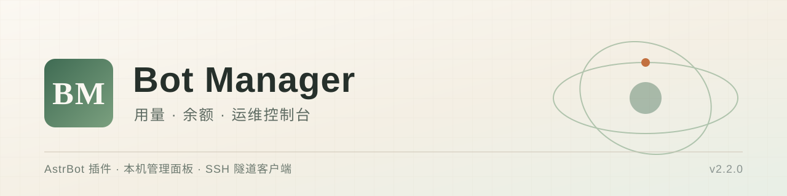

# Bot Manager



把 AstrBot 的**模型与向量用量**、**DeepSeek 余额与提醒**、**服务器运维面板**和
**远程客户端**收成一套东西。插件负责采集与提醒，本机面板负责查询与展示，
客户端负责用 SSH 私钥把面板安全地拉到你自己电脑上。

技术 ID 沿用 `astrbot_plugin_usage_telemetry`，历史配置与状态不需要迁移。

> 三端各管一段：插件（采集 + 提醒 + 凭据下发）→ 面板（查询 + 展示 + 采样）→ 客户端（隧道 + 打开面板）。
> 只装插件即可使用用量查询与指令查询；余额、搜索汇总和网页需要配套服务；
> 面板只监听服务器回环地址，公网直连打不开，必须经 SSH 隧道访问。
> 目标仓库 [AKIhunter/astrbot_plugin_bot_manager](https://github.com/AKIhunter/astrbot_plugin_bot_manager)，
> 发布包与仓库源码以本仓库记录为准；本地验收不代表其他部署环境可用。

## 能做什么

| 你希望 | 行为与边界 |
| --- | --- |
| 知道钱花在哪个插件 | 包装 AstrBot 提供商与底层客户端，按插件汇总调用、Token 与未知用量；排行只显示前 10 项 |
| 分清聊天和记忆的消耗 | 模型调用与向量调用分别计量；重试、取消、失败按请求明细保留，不以一条记录概括 |
| 搜索费用别混进模型账单 | 单独计量 DeepSeek 搜索与网页抓取次数，按你配置的单价换算 |
| 余额不足先知道 | 按周期查询 DeepSeek 人民币余额，跌破阈值提醒一次；充值后按人设致谢一次，不会循环刷屏 |
| 提醒发给我或群里 | 插件设置页填 QQ 号与群号即可指定目标，没填时回退到「记住管理员最近会话」的旧行为 |
| 从插件里配好余额和面板 | 插件设置页可直接填 DeepSeek 密钥与面板账号密码，改动后自动下发到本机面板，改密立即生效 |
| 手机/异地也能看面板 | 面板绑定 `127.0.0.1`，用客户端配 SSH 私钥建隧道，在自己电脑的浏览器里打开 |
| 忘了插件有哪些指令 | 读取真实注册表，列出名称、别名、参数、权限与停用状态；查询不会执行命令 |

不做的事：不自动切换更便宜的模型、不替你限额或充值、不复制其他插件的数据库、
不在未授权时执行任何指令。余额提醒文案可能由会话模型生成，本身也产生消耗。

## 第一次使用

1. **装插件**：AstrBot >=4.29.0，通过仓库地址安装
   `https://github.com/AKIhunter/astrbot_plugin_bot_manager`，或从市场安装
   `astrbot_plugin_usage_telemetry`。装好启用后，用管理员发送 `/bm 状态`。
2. **验证采集**：让机器人正常完成一次模型任务，再发 `/bm 用量 今天`；
   看到本次调用与 Token 即成功，拿不到上游用量时应显示「未知」，不是 0。
3. **接配套服务**（需要余额/搜索/网页时）：在 Linux + systemd 服务器上克隆本仓库，
   执行 `sudo sh service/install-server.sh service`。详见[安装与服务](docs/installation.md)。
4. **在插件里填凭据**：插件设置页「Bot Manager 集成管理」→ 填 DeepSeek 余额密钥、
   管理面板登录账号与密码。保存后发 `/bm 凭据` 确认「已同步」。
5. **连面板**：服务器上 `systemctl status bot-manager` 正常后，用
   [客户端](docs/client.md)填服务器、私钥、面板账密，点「连接并打开面板」。

### 默认开关

| 配置 | 默认 | 说明 |
| --- | --- | --- |
| `notice_enable` | `true` | 余额提醒总开关；关闭后不再轮询余额，`/bm 余额` 仍可手动查 |
| `low_balance_threshold` | `5.0` | 低于该金额进入一个低余额周期，回升后复位 |
| `check_interval_minutes` | `5` | 余额轮询间隔，最小 1 分钟 |
| `notify_target_qq` / `notify_target_groups` | 均空 | 空且 `fallback_auto_channel` 开时走旧自动渠道 |
| `fallback_auto_channel` | `true` | 关闭后未配置目标就完全不发提醒 |
| `recharge_thanks_enable` / `recharge_thanks_group` | 均 `true` | 充值致谢开关与是否也发群 |
| `deepseek_api_key` | 空 | 填了才下发；留空沿用面板里已保存的密钥 |
| `panel_admin_username` / `panel_admin_password` | 空 | 两者都填才下发，改密后面板热加载生效 |
| `credential_sync_enable` / `credential_sync_interval_minutes` | `true` / `30` | 只在配置指纹变化时推送，不覆盖面板手工修改 |
| `low_balance_custom_text` / `recharge_thanks_custom_text` | 空 | 留空按人设生成，可用 `{balance}` `{threshold}` 占位 |

以 [`_conf_schema.json`](_conf_schema.json) 为准；环境变量 `BOT_MANAGER_INTERNAL_BASE_URL`
与 `BOT_MANAGER_INTERNAL_TOKEN_PATH` 可改配套服务地址与令牌路径，须在启动 AstrBot 前设置。

## 导航

- [安装与配套服务](docs/installation.md)
- [配置项与凭据下发](docs/configuration.md)
- [客户端与 SSH 隧道](docs/client.md)
- [内部接口](docs/api.md)
- [独立维护与版本来源](docs/maintenance.md)

插件市场只安装根目录的插件源码；`service/`、`client/`、`docs/`、`tools/` 通过
`.gitattributes` 的 `export-ignore` 排除在 `git archive` 产物之外。
GitHub 自动生成的源码 ZIP 是否遵循该规则取决于平台行为，若看到这些目录，
安装时以仓库根目录（`main.py` + `metadata.yaml`）为插件本体即可。
Release 附件里的插件 ZIP 是我们自己打包的，只含插件文件。

## 隐私与凭据

插件配置里的 DeepSeek 密钥与面板账密只在**本机回环**传输：插件用
`/etc/bot-manager/plugin-token` 里的内部令牌调用面板内部接口，面板以 scrypt
（salt 16 字节、n=2^14、r=8、p=1）保存口令摘要，改密前自动备份并保留 8 份。

客户端配置保存在 `%LOCALAPPDATA%\BotManagerClient\settings.json`，
密码与私钥口令用 Windows DPAPI 按当前用户加密，换用户或换机器都无法解密。
带口令的私钥会在会话目录解密出一份临时副本供本次连接使用，断开或退出即删除。

仓库不接收任何账户凭据：`.gitignore` 排除 `*.pem`、`*.key`、`*.db`、`*.token`、
`plugin_data/` 等路径；文档里的 QQ 号、群号、服务器地址一律为占位符。
内部令牌、API Key、SSH 私钥、数据库文件都不应出现在提交里。

## 兼容性与部署

AstrBot >=4.29.0，Python 3.10+，插件与配套服务都只用标准库，无额外依赖。
配套服务的安装器面向 **Linux + systemd + `/var/lib/astrbot` + `astrbot` 系统用户**，
不是 Windows/macOS 或任意 Docker 布局的一键安装器；其他布局需自行适配路径、权限与网络。

客户端面向 Windows 10/11 自带的 OpenSSH（`ssh.exe` / `ssh-keygen.exe`）与 PowerShell 5.1，
不需要额外运行时。客户端提供单文件 exe（Release 附件）与可复现构建脚本。

面板只监听 `127.0.0.1:17321`，认证为 HTTP Basic + scrypt 摘要；
`/etc/bot-manager/credentials.json` 与 `provider-credentials.json` 权限为 `600 root:root`。
侧栏「SSH 隧道目标」由 `/etc/bot-manager/tunnel-target` 提供，未配置时显示占位符。

## 失败边界

`/bm 用量` 统计的是**本地已采集**记录，采集前历史不会自动补齐；
上游未返回用量时标为「未知」，未知不等于免费，需与官方账单对账。
`/bm 搜索` 只覆盖已接入的 DeepSeek 搜索/抓取工具，不是通用搜索计量器。

提醒送达不可强保证：平台不可用或返回值未知时不重发、不退款，
「没收到提醒」不能当作余额充足。同一低余额周期只提醒一次，`sent` 后不再重试。

凭据下发是**尽力而为**：面板未运行、令牌失效或用户名为空时该项失败并记录在
`/bm 凭据` 里，本地配置不受影响，也不会回滚已生效的另一项。
把插件配置清空只会撤销本地下发记录，**不会**删除面板上已保存的凭据。

客户端隧道依赖服务器 SSH 可达：私钥未授权、口令错误、端口被占用时会在界面给出
明确原因；隧道建立后若面板无响应，通常是 `bot-manager` 服务未运行。

## 常见问题

**只装插件能用吗？** 能查用量、搜索计量与指令；余额、搜索汇总、网页要配套服务。

**`/bm 用量` 为什么比官方账单少？** 只统计经过本插件包装的路径，插件自行发起的
独立 HTTP 请求、采集开始前的历史都不在范围内；先看「未知用量」，再去官方对账。

**为什么装了配套服务还是查不到余额？** 面板侧没有可用凭据，或面板没运行。
在插件里填 `deepseek_api_key` 后看 `/bm 凭据`，或直接在面板「接口配置」页填一次。

**改面板密码要重启吗？** 不用。面板按文件 mtime 热加载口令摘要，保存后立即生效；
文件写坏时保留旧口令，避免把自己锁在外面。

**提醒为什么没发到群里？** 先看 `/bm 通知`：目标是否为空、平台标识是否推断出来、
`recharge_thanks_group` 是否被关。未配置且回退关闭时，插件按设计不发任何消息。

**能不能直接连面板的 17321？** 不能，面板只绑回环地址。要么 SSH 隧道，
要么用客户端；两者都需要服务器账号或私钥。

## 指令与开发

全部管理入口仅限 AstrBot 管理员，默认前缀 `/`，入口支持 `/bm`、`/botmanager`、`/bot管理`。

| 指令 | 功能 |
| --- | --- |
| `/bm`、`/bm 帮助` | 帮助图或完整指令说明 |
| `/bm 状态` | 采集挂钩、搜索计量、提醒与凭据任务状态 |
| `/bm 余额` | DeepSeek 实时余额（兼容 `/余额`、`/钱包`、`/账户余额`） |
| `/bm 用量 [时间]` | 调用、Token、未知用量与插件排行 |
| `/bm 搜索 [时间]` | 搜索/抓取次数与计量费用 |
| `/bm 通知` / `/bm 通知 测试` | 查看提醒配置 / 向目标发一条测试消息 |
| `/bm 凭据` / `/bm 凭据 同步` | 查看凭据同步状态 / 立即重新下发 |
| `/bm 指令`、`/bm 详情` | 注册指令列表 / 完整原生命令说明 |

时间支持 `今天`、`昨天`、`7天`、`30天`、`全部`，按北京时间。

插件自检与联调（在仓库根目录）：

```bash
python3 -m py_compile main.py command_query.py runtime_paths.py search_meter.py usage_query.py
python3 -m json.tool _conf_schema.json > /dev/null
```

客户端自检（Windows，无界面）：

```powershell
powershell -NoProfile -STA -File client\BotManagerClient.ps1 -SelfTest
powershell -NoProfile -STA -File client\BotManagerClient.ps1 -Diagnose
powershell -NoProfile -ExecutionPolicy Bypass -File client\build-client.ps1
```

服务端发布用 `tools/deploy-release.py`：复制当前 release → 覆盖暂存文件 →
重算 `SHA256SUMS` → `mv -T` 原子切换 `current` 软链接，可选重启服务。

## 更新日志与来源

版本见 [metadata.yaml](metadata.yaml)，变更见 [CHANGELOG.md](CHANGELOG.md)。
2026-11-02 起本仓库同时维护插件与配套服务，不再使用「总库 + 发布镜像」双份源码，
日常修改直接在本仓库完成，详见[独立维护](docs/maintenance.md)。
本项目为独立实现，不声称任何上游背书；MIT 仅适用于本仓库权属明确的新写内容。
Banner 为原创几何图形与字标，不使用第三方素材。

发布资产：插件 ZIP（仅插件文件）、客户端 exe 与 SHA256 清单；
资产中不含密钥、令牌、服务器地址或真实 QQ/群号。
